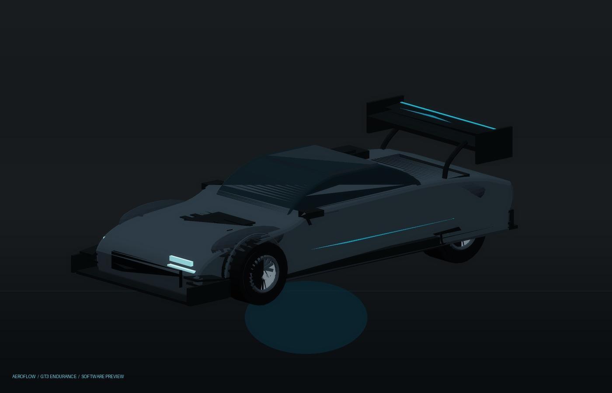

# AeroFlow Platform

[](https://github.com/YChoux-Pan/aeroflow-platform/actions/workflows/ci.yml)


AeroFlow is an open, modular platform for **vehicle design prompts, racing-car
assets, and real-time aerodynamic exploration** in the DeepSeek Harness (DSH)
Web UI.

It combines four things in one maintainable repository:

1. **AeroFlow Lab** — an installed DSH plugin with a 3D wind tunnel,
   white-smoke streamline visualization, drag telemetry, and OBJ/GLB/GLTF
   vehicle import.
2. **Prompt engineering** — a deterministic prompt compiler, schemas,
   templates, examples, and design guardrails for original racing-car concepts.
3. **Skills library** — pinned, license-audited snapshots of five upstream
   vehicle-design, 3D-generation, camera, prompt, and automotive-engineering
   skill groups.
4. **Racing model assets** — original, procedurally generated test vehicles in
   GLB, glTF, and OBJ, with reproducible generator code. AeroFlow GT3 Endurance
   is generated from the installed GT3 prompt package.

> AeroFlow's flow field is a real-time visual proxy driven by a transparent
> aerodynamic load model. It is **not** a CFD solver and must not be treated as
> validated engineering analysis.

**Version:** `1.2.0` · **Plugin package:** `aeroflow-dsh-plugin` ·
**DSH:** Web UI · **License:** MIT (our code; upstream snapshots keep their own
licenses).

---

## Why this repository exists

Building a car model is not just one prompt. It is a chain:

```text
design brief
  → proportions and silhouette
  → multi-view reference images
  → image-to-3D
  → clean GLB/GLTF
  → import and aerodynamic exploration
  → validation notes and iteration
```

AeroFlow keeps every link of that chain in one place, with pinned sources,
reproducible outputs, and a recorded maintenance history.

## Repository map

| Path | What lives there |
|---|---|
| [`plugin/`](plugin/) | Installable DSH bundle, client source, locales, build tool, import smoke tests |
| [`prompts/`](prompts/) | Prompt schema, taxonomy, templates, examples, generated packages, negative constraints |
| [`skills/`](skills/) | Five upstream skill source groups, plus the original AeroFlow vehicle-prompt-engineer skill |
| [`models/racing/`](models/racing/) | Original AeroFlow Formula 01 and GT3 Endurance in GLB, glTF, and OBJ; generators and per-model manifests |
| [`scripts/`](scripts/) | Prompt compiler, repository verifier, installer helpers, plugin packaging |
| [`docs/`](docs/) | Architecture, plugin guide, installation, prompt workflow, validation, maintenance, journal |
| [`.github/`](.github/) | CI, release workflow, issue/PR templates |

## Quick start

### 1. Install the DSH plugin

```bash
git clone https://github.com/YChoux-Pan/aeroflow-platform.git
cd aeroflow-platform
```

**Recommended:** open DSH Web → **Plugins** → add/install a local bundle →
select this repository's [`plugin/`](plugin/) directory. Enable the
`aeroflow-dsh-plugin` bundle.

You can also ask the DSH agent on that machine:

> Install the DSH bundle at `<absolute-path>/aeroflow-platform/plugin` with
> `plugin_manager` and enable it.

CLI alternative:

```bash
dsh plugin --profile desktop add "<absolute-path>/aeroflow-platform/plugin"
```

This installs the package into the profile. If your profile does not
auto-select the bundle, enable it once in **Plugins**; a restart is the safe
fallback. See [`docs/installation.md`](docs/installation.md) for the exact
flows and troubleshooting.

After installation, open a conversation in DSH. The **AeroFlow wind tunnel**
strip appears above the composer. Click it to open the lab.

### 2. Try the import path

Import [`models/racing/aeroflow-gt3-endurance.glb`](models/racing/aeroflow-gt3-endurance.glb)
or [`models/racing/aeroflow-formula-01.glb`](models/racing/aeroflow-formula-01.glb)
through **Import vehicle mesh**. Both models are also available as `.gltf` and
`.obj` to exercise all three loaders.

### 3. Generate a prompt package

```bash
node scripts/prompt-engine.mjs \
  --spec prompts/examples/gt3-endurance.json \
  --mode all \
  --out prompts/generated/my-gt3.md
```

Open the generated Markdown, copy the reference-set prompts, and generate the
separate views. Read [`prompts/README.md`](prompts/README.md) before using the
reference set for a 3D generation.

### 4. Rebuild the plugin (contributors)

```bash
cd plugin/tools
pnpm install
node build.mjs
node run-import-smoke.mjs
```

The runtime bundle is [`plugin/client.js`](plugin/client.js); React is supplied
by DSH and must never be bundled.

## Generated racing model

The first model generated from the installed prompt pipeline is **AeroFlow GT3
Endurance**. It is an original, brand-free GT3 concept with a long hood, wide
track, swan-neck rear wing, front splitter, canards, roof scoop, and cyan accent
livery.



- Design spec: [`prompts/examples/gt3-endurance.json`](prompts/examples/gt3-endurance.json)
- Compiled prompt: [`prompts/generated/gt3-endurance.md`](prompts/generated/gt3-endurance.md)
- Assets: [`models/racing/aeroflow-gt3-endurance.glb`](models/racing/aeroflow-gt3-endurance.glb)
  · [glTF](models/racing/aeroflow-gt3-endurance.gltf) · [OBJ](models/racing/aeroflow-gt3-endurance.obj)
- Previews: [`models/racing/previews/`](models/racing/previews/) — offline
  software previews, not AeroFlow WebGL captures.

## AeroFlow Lab capabilities

- Immersive full-frame 3D wind tunnel opened from the composer dock.
- Six parametric test articles: Hellcat-inspired widebody, GT coupe, cargo rig,
  quadrotor, winged pod, bluff pod.
- **White-smoke flow language** — camera-facing, procedurally eroded smoke
  ribbons plus soft puffs, deflected by the body and rolled up in the wake.
- **OBJ / GLB / glTF import** — up to 16 MB; self-contained glTF only.
- glTF PBR materials preserved; OBJ uses the AeroFlow hard-surface treatment.
- Wind direction 0–359° and wind speed 0–100 m/s.
- Live smoke streamlines with body deflection, wake turbulence, floor effect.
- Force-balance drift and pitch, drag vector visualization.
- Real drag load, dynamic pressure, drag power, Reynolds number, CdA, frontal
  area, and a rolling telemetry chart.
- Automatic smoke palette, manual palette override, camera views, orbit, pause,
  reset, smoke toggle, force vector, bilingual UI, keyboard focus management.
- Clear unsupported-format messages for Draco, Meshopt, KTX2, and external glTF
  resources.

The Hellcat preset is an original AeroFlow interpretation of the American
widebody muscle-car language: long hood, black scoop, quad projector lamps, wide
fenders, side skirts, diffuser, quad exhausts, and ducktail spoiler. No
manufacturer badge, logo, or production geometry is used.

## Skills library

The pinned five source groups are documented in
[`skills/README.md`](skills/README.md) and [`skills/SOURCES.json`](skills/SOURCES.json):

1. SummerEngine `vehicle-model` — 3D hard-surface vehicle generation.
2. omer-metin `vehicle-design` — proportion, stance, silhouette, validation.
3. xoxxel `camera-prompts` — racing-car camera language (metadata only because
   upstream has no license).
4. Evolink GPT-Image prompt library — CC0 inspiration corpus.
5. Automotive engineering (two upstream repositories) — engineering and
   functional-safety context, explicitly not styling prompts.

The original [`aeroflow-vehicle-prompt-engineer` skill](skills/aeroflow-vehicle-prompt-engineer/SKILL.md)
ties these sources into the AeroFlow prompt pipeline.

## Verification

Run the full repository check:

```bash
node scripts/verify.mjs
```

It validates the plugin manifest and client bundle, locale key parity, the
prompt examples, generated prompts, the skill source lockfile, and the racing
asset catalog with per-model manifests. The plugin's GLB/GLTF/OBJ import path has
its own smoke test:

```bash
cd plugin/tools
node run-import-smoke.mjs
```

Visual/WebGL verification remains a manual step; see
[`docs/validation.md`](docs/validation.md).

## Maintenance

- **Changelog:** [`CHANGELOG.md`](CHANGELOG.md)
- **Roadmap:** [`ROADMAP.md`](ROADMAP.md)
- **Project journal:** [`docs/journal.md`](docs/journal.md)
- **Maintenance runbook:** [`docs/maintenance.md`](docs/maintenance.md)
- **Architecture:** [`docs/architecture.md`](docs/architecture.md)

The repository is designed for long-term maintenance: pinned third-party
commits, explicit licenses, a deterministic prompt compiler, generated asset
manifests, CI on every push, and a release workflow for the installable plugin
bundle.

## License and attribution

Our original source, documentation, prompts, and racing model are MIT-licensed
(see [`LICENSE`](LICENSE)). Vendored skills retain their upstream licenses; see
[`THIRD_PARTY_NOTICES.md`](THIRD_PARTY_NOTICES.md) and the `LICENSE` file in each
vendor directory. `camera-prompts` upstream content is not redistributed because
no license was found.

AeroFlow is not affiliated with any automotive manufacturer, racing team, or the
upstream skill authors.

---

## 中文简介

AeroFlow 是一个面向载具造型与空气动力探索的开源工程：包含 DSH 3D 白烟风洞插件、
可复现的赛车提示词工程、五个上游 skills 工程的许可证审计快照，以及原创赛车
GLB/glTF/OBJ 资产。插件支持 OBJ/GLB/GLTF 导入；默认测试件为 Hellcat 宽体风格的
原创程序化模型；流场是实时白烟可视化代理模型，不是 CFD 求解器。
